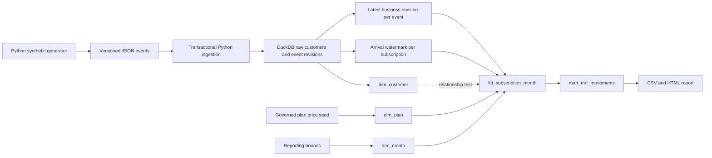

# Subscription analytics engineering

An original, runnable analytics platform for a fictional subscription business: Python ingestion, DuckDB storage, and tested dbt models turn subscription events into a reconciled monthly recurring revenue (MRR) report.

The engineering question is practical: **can a monthly revenue report remain explainable when source records are replayed, corrected, or delivered late?** This project preserves source revisions, rebuilds affected subscription histories, and checks the result against a full refresh.

All records are generated from a fixed random seed. No employer code, customer records, external datasets, cloud accounts, or credentials are used. The results demonstrate pipeline behaviour; they are not commercial achievements.

## What to inspect

| Evidence | What it demonstrates |
| --- | --- |
| [Transactional Python ingestion](src/subscription_analytics/ingest.py) | Explicit source contracts, idempotent replay, conflict detection and batch rollback |
| [Incremental monthly fact](models/marts/fct_subscription_month.sql) | Dimensional modelling, arrival watermarks, late-data correction and traceability |
| [MRR movement model](models/marts/mart_mrr_movements.sql) | Governed metric definitions and a reconciled opening-to-closing bridge |
| [Integration tests](tests/test_pipeline.py) | Hand-calculated expectations, multiple subscriptions per customer, revision ordering and incremental/full-refresh parity |
| [Data tests](models/schema.yml) and [business assertions](dbt_tests) | Grain, relationships, missing mappings, valid states and reconciliation |
| [Example output](docs/example/monthly_metrics.csv) | Inspectable synthetic results, also generated as a standalone HTML report |

## Architecture and lineage



The reporting fact has **one row per subscription and month**, including inactive months. The aggregate has **one row per month**. Customer counts are distinct, so a customer with two subscriptions is not counted twice. [Model grains and contracts](docs/data-contracts.md) describe each layer.

## Quick start

Requires Python **3.12 or 3.13**, Git, and network access for the initial dependency installation. No services or containers are required. Run from the repository root:

```bash
python3 -m venv .venv
source .venv/bin/activate
python -m pip install -r requirements.lock
python -m pip install --no-deps -e .
subscription-analytics demo
```

Open `reports/index.html` in a browser. The full movement bridge is in `reports/monthly_metrics.csv`, and the database is `data/warehouse.duckdb`. Generated data, databases, logs and build artifacts are ignored by Git.

Run `subscription-analytics demo` again: it inserts **zero** new event revisions and reproduces the report. Use a fresh database when changing generator parameters:

```bash
subscription-analytics demo --seed 7 --customers 50 --database data/alternative.duckdb
```

The stages can also run independently:

```bash
subscription-analytics generate
subscription-analytics ingest
subscription-analytics build
subscription-analytics report
```

See [operations](docs/operations.md) for corrections, full refreshes, failure recovery and dbt documentation generation.

## Design choices and technical challenges

- **DuckDB + dbt:** inspectable SQL and a local analytical database make the project reproducible without infrastructure administration. Python owns generation and ingestion; SQL owns business transformations.
- **Arrival order and business order are different:** an ingestion sequence identifies newly received records, while the highest event revision wins in staging. A late, lower revision cannot overwrite a newer correction.
- **Incremental work is bounded by changed subscriptions:** a new revision triggers recomputation of every reporting month for that subscription. This handles old effective dates without an arbitrary lookback window. Small dimensions and the aggregate are rebuilt for simplicity.
- **Replay is explicit:** the same event ID and revision with identical content is a no-op. Different content for the same key fails the whole batch. Corrections require a higher revision.
- **Currency is exact:** prices and MRR use integer CHF cents. No floating-point arithmetic enters metric logic.
- **Ambiguity fails the quality gate:** unknown plans, duplicate effective dates and records outside the reporting window fail dbt tests rather than silently producing accepted reports.

## Metric definitions

MRR is the full contracted monthly price of subscriptions active at month end. It is **not** recognised revenue, invoice totals, cash, or prorated billing. Changes within a month are netted at month end.

```text
closing MRR = opening MRR + new + reactivation + expansion - contraction - churn
```

New MRR means the first positive month in the configured window. Reactivation follows a zero-MRR month after an earlier active month. Expansion and contraction compare two positive month-end balances. Churn is a move from positive to zero. The demonstration begins with no opening subscriptions; inputs outside the configured 2025 window are rejected. [Full metric definitions](docs/metrics.md) include interpretation limits and ownership.

## Testing and quality assurance

```bash
ruff check .
ruff format --check .
pytest -q
subscription-analytics demo --full-refresh
```

The Python suite tests deterministic generation, valid and invalid input, conflicting replay rollback, identity restrictions, expected MRR values, late historical corrections, stale revisions, replay stability, and full-refresh parity. The dbt build checks 39 data assertions. The [CI workflow](.github/workflows/ci.yml) runs lint, tests and the demo on Python 3.12 and 3.13 and retains report/build artifacts for seven days.

## Observed example

Running the default seed (`42`) generates **120 fictional customers, 351 event revisions, 1,440 subscription-month rows and 12 reporting months**. December closes at **CHF 6,792 MRR across 68 active subscriptions**. These values are synthetic outputs from an executed pipeline, not evidence of business growth or model performance.

The [committed CSV](docs/example/monthly_metrics.csv) and [HTML example](docs/example/index.html) are generated outputs for review. Regenerate them from `reports/` after changing source logic; do not manually edit reported numbers.

## Limitations and lessons

- This is a single-process local analytical workflow, not a production billing service. It has no scheduler, API, authentication layer or distributed writes.
- The model supports monthly CHF plans and a fixed reporting window. Trials, discounts, annual contracts, tax, FX, invoicing and recognised revenue are deliberately outside scope.
- Plan prices, customer attributes and subscription ownership are immutable. Historical dimension changes would need explicit effective-dated models. Changing a price seed, reporting bounds or transformation logic requires a full refresh.
- Corrections can change historical results. Source revisions remain available to explain the change; an as-of-arrival reporting interface is not implemented.
- Physical source deletion is unsupported. A cancellation is a business event; erasing a mistaken event would require a separately designed tombstone contract.
- Tests establish correctness on representative cases. They do not establish warehouse-scale performance or production service reliability.

The main lesson is that reproducibility includes business semantics and history handling, not just a successful command. [Publication review](docs/publication-review.md) records the source and ownership boundary for this original project.

## License and references

Original implementation and synthetic examples: [MIT](LICENSE). Dependencies retain their own licenses.

Primary technical references: [dbt incremental models](https://docs.getdbt.com/docs/build/incremental-models), [dbt data tests](https://docs.getdbt.com/docs/build/data-tests), and the [dbt-duckdb adapter](https://github.com/duckdb/dbt-duckdb).
